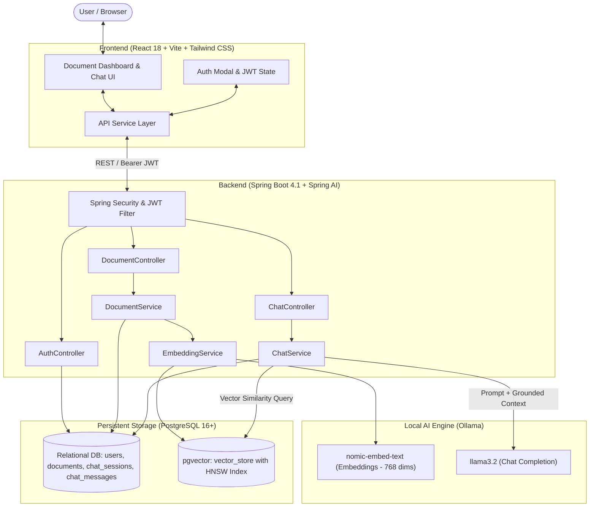
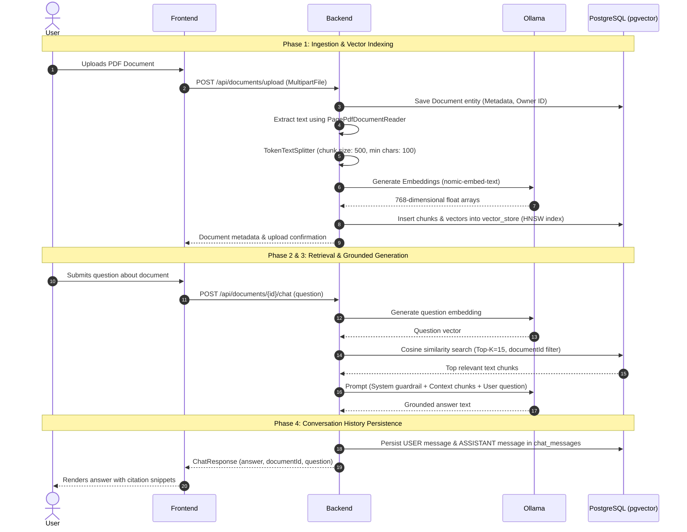

# DocAnalyzer (docAnlz)

An intelligent, full-stack **Retrieval-Augmented Generation (RAG)** document analysis platform. DocAnalyzer allows users to securely authenticate, upload PDF documents, automatically generate dense vector embeddings, and converse interactively with their documents using locally hosted large language models (LLMs) with strict anti-hallucination guardrails and persistent conversation history.

---

## Overview

DocAnalyzer bridges the gap between private enterprise documentation and conversational AI. Traditional LLMs are prone to hallucinating and lack knowledge of proprietary or private documents. DocAnalyzer solves this by indexing PDF documents into a PostgreSQL vector database (`pgvector`) using dense vector embeddings, retrieving the most relevant context chunks for a user query via cosine distance search, and injecting that context directly into the prompt template of a locally deployed Ollama model.

---

## Key Features

- **User Authentication & Authorization**:
  - Secure user registration and login with BCrypt password hashing.
  - Stateless JWT (JSON Web Token) authentication integrated with Spring Security and OAuth2 Resource Server.
  - Strict multi-tenant data isolation ensuring users only access and query their own documents and chat sessions.
  - Global exception handling providing unified, descriptive JSON error responses.

- **Document Ingestion & Management**:
  - Multi-part PDF upload with MIME type and content verification.
  - Document metadata persistence (file name, type, size, upload timestamp, owner).
  - Cascade deletion: Purges document metadata, relational chat sessions, message histories, and corresponding high-dimensional vector embeddings from `vector_store`.

- **RAG-Powered Chatbot with History**:
  - Semantic vector similarity search against document chunks using PostgreSQL HNSW cosine indexing.
  - Contextual prompting with strict system guardrails instructing the LLM to answer strictly from the source document context.
  - Persistent multi-turn chat sessions and historical message storage (`USER` and `ASSISTANT` roles).
  - Chat history reload upon document switching in the client UI.

- **Modern Responsive Frontend**:
  - High-performance Single Page Application (SPA) built with React 18, Vite, and Tailwind CSS.
  - Real-time indexing indicators, citation source inspection drawer, quick-action prompt suggestions, and responsive document management dashboard.
  - Dual-mode client: Seamless live API communication with a built-in mock fallback for offline development.

---

## System Architecture



---

## Methodology

DocAnalyzer implements a 4-phase Retrieval-Augmented Generation methodology:



### 1. Ingestion & Embedding Pipeline
1. **Extraction**: Uploaded binary PDF streams are parsed into individual page objects using Spring AI's `PagePdfDocumentReader`.
2. **Chunking**: Documents are segmented using `TokenTextSplitter` configured with a chunk size of 500 tokens, a minimum chunk size of 100 characters, and separator preservation to prevent loss of semantic boundaries.
3. **Metadata Association**: Every generated chunk is tagged with the parent `documentId`.
4. **Vector Embedding**: Chunks are transformed into 768-dimensional dense vectors using Ollama's `nomic-embed-text` embedding model and stored in the PostgreSQL `vector_store` table.

### 2. Semantic Retrieval
- Queries sent to `/api/documents/{documentId}/chat` trigger a filtered similarity search in Spring AI's `VectorStore`.
- A metadata filter (`b.eq("documentId", documentId)`) guarantees tenant and document boundary isolation.
- The PostgreSQL `pgvector` store evaluates cosine similarity across the pre-calculated HNSW index to retrieve the top $K=15$ most relevant chunks.

### 3. Grounded Generation & Guardrails
- Retrieved text snippets are compiled into a unified context payload.
- Spring AI `ChatClient` prompts the local `llama3.2` model using a strict system instruction:
  > *"Answer the user's question using ONLY the information provided in the document context. If the answer cannot be found in the context, clearly state that the information is not available in the document. Do not invent facts. Do not use outside knowledge."*
- This approach eliminates hallucination and guarantees verifiable, fact-based answers.

### 4. Conversational History & Persistence
- For each user and document pair, a unique `ChatSession` is initialized or retrieved.
- Every exchange is persisted as two distinct `ChatMessage` entries:
  - Role: `USER` with the prompt query.
  - Role: `ASSISTANT` with the synthesized response.
- Chat history is loaded via `/api/documents/{documentId}/chat/history`, preserving conversational context across browser sessions.

---

## Project Structure

```text
docAnlz/
├── frontend/                               # React + Vite client application
│   ├── public/                             # Static assets
│   ├── src/
│   │   ├── components/                     # Modular React UI components
│   │   │   ├── AuthModal.jsx               # Login & Register modal dialog
│   │   │   ├── ChatScreen.jsx              # Conversational interface & history viewer
│   │   │   ├── DeleteConfirmModal.jsx      # Confirmation modal for doc deletion
│   │   │   ├── DocumentDashboard.jsx       # Document repository & stats grid
│   │   │   ├── ErrorAlert.jsx              # Toast & contextual alert components
│   │   │   ├── Header.jsx                  # Top navigation, status & user profile
│   │   │   ├── LoadingState.jsx            # Skeleton loaders & spinner states
│   │   │   ├── SourceViewer.jsx            # Slide-out drawer for inspecting citations
│   │   │   └── UploadScreen.jsx            # Drag-and-drop PDF upload & indexing view
│   │   ├── services/
│   │   │   └── api.js                      # Centralized API client & mock fallback
│   │   ├── App.jsx                         # Main application container & tab routing
│   │   ├── index.css                       # Global Tailwind CSS definitions
│   │   └── main.jsx                        # React root entry point
│   ├── index.html                          # HTML template
│   ├── package.json                        # Frontend dependencies & scripts
│   ├── postcss.config.js                   # PostCSS configuration
│   ├── tailwind.config.js                  # Tailwind design system configuration
│   └── vite.config.js                      # Vite server & API reverse-proxy setup
│
├── src/                                    # Spring Boot backend application
│   └── main/
│       ├── java/com/AIR/docAnlz/
│       │   ├── config/
│       │   │   └── SecurityConfig.java     # Security filter chain, CORS, JWT decoder
│       │   ├── controller/
│       │   │   ├── AuthController.java     # /api/auth registration and login
│       │   │   ├── ChatController.java     # /api/documents/{id}/chat & history
│       │   │   └── DocumentController.java # /api/documents upload, list, delete
│       │   ├── dto/
│       │   │   ├── AuthResponse.java       # Token & user profile response
│       │   │   ├── ChatRequest.java        # Chat question payload
│       │   │   ├── ChatResponse.java       # Chat answer & metadata payload
│       │   │   ├── LoginRequest.java       # User credentials payload
│       │   │   └── RegisterRequest.java    # New account payload
│       │   ├── exception/
│       │   │   ├── GlobalExceptionHandler.java # REST exception translator
│       │   │   └── UserAlreadyExistsException.java
│       │   ├── model/
│       │   │   ├── ChatMessage.java        # Chat message JPA entity
│       │   │   ├── ChatSession.java        # Chat session JPA entity
│       │   │   ├── Document.java           # Document metadata JPA entity
│       │   │   ├── MessageRole.java        # Enum (USER, ASSISTANT)
│       │   │   ├── Role.java               # Enum (USER, ADMIN)
│       │   │   └── User.java               # User account entity
│       │   ├── repository/
│       │   │   ├── ChatMessageRepository.java
│       │   │   ├── ChatSessionRepository.java
│       │   │   ├── DocumentRepository.java
│       │   │   └── UserRepository.java
│       │   ├── security/
│       │   │   ├── CurrentUserService.java # Security context user resolver
│       │   │   └── JwtService.java         # JJWT token generation & signing
│       │   ├── service/
│       │   │   ├── AuthService.java        # Authentication business logic
│       │   │   ├── ChatService.java        # Similarity search & LLM prompt execution
│       │   │   ├── DocumentService.java    # PDF parsing, chunking & cascade delete
│       │   │   └── EmbeddingService.java   # pgvector storage & vector deletion
│       │   └── DocAnlzApplication.java     # Spring Boot application runner
│       └── resources/
│           └── application.properties      # Backend datasource, AI & JWT config
├── pom.xml                                 # Maven dependencies & build specification
└── README.md                               # Project documentation
```

---

## Tech Stack

| Domain | Technology / Library | Description |
| :--- | :--- | :--- |
| **Backend Framework** | Spring Boot 4.1.1 | Enterprise Java application core |
| **Language** | Java 17 | Core backend runtime |
| **AI Orchestration** | Spring AI 2.0.1 | RAG pipelines, chunking, and model integration |
| **Local LLM Engine** | Ollama | Local execution of `llama3.2` & `nomic-embed-text` |
| **Vector Database** | PostgreSQL + `pgvector` | High-dimensional vector indexing (HNSW, Cosine) |
| **ORM / Data Access** | Spring Data JPA / Hibernate | Object-relational mapping & CRUD |
| **Security & Auth** | Spring Security + Nimbus JWT | Stateless OAuth2 resource server, BCrypt |
| **Frontend Framework**| React 18 | Declarative component UI |
| **Build Tool (Client)**| Vite 5 | Rapid HMR frontend bundler |
| **Styling** | Tailwind CSS v3 | Modern dark-mode utility-first styling |
| **Icons** | Lucide React | Clean, scalable vector UI icons |

---

## API Reference

### Authentication Endpoints

#### Register a new user
```http
POST /api/auth/register
Content-Type: application/json

{
  "email": "user@example.com",
  "password": "securePassword123"
}
```
**Response (200 OK):**
```json
{
  "token": "eyJhbGciOiJIUzI1NiJ9...",
  "userId": 1,
  "email": "user@example.com",
  "role": "USER"
}
```

#### Login
```http
POST /api/auth/login
Content-Type: application/json

{
  "email": "user@example.com",
  "password": "securePassword123"
}
```
**Response (200 OK):**
```json
{
  "token": "eyJhbGciOiJIUzI1NiJ9...",
  "userId": 1,
  "email": "user@example.com",
  "role": "USER"
}
```

---

### Document Endpoints

> All document and chat endpoints require the header: `Authorization: Bearer <JWT_TOKEN>`

#### Upload a PDF Document
```http
POST /api/documents/upload
Content-Type: multipart/form-data

file: <binary_pdf_file>
```
**Response (200 OK):**
```json
{
  "id": 12,
  "fileName": "Annual_Report_2026.pdf",
  "fileType": "application/pdf",
  "fileSize": 1048576,
  "uploadedAt": "2026-11-05T19:30:00"
}
```

#### Get All Documents for Authenticated User
```http
GET /api/documents
```
**Response (200 OK):**
```json
[
  {
    "id": 12,
    "fileName": "Annual_Report_2026.pdf",
    "fileType": "application/pdf",
    "fileSize": 1048576,
    "uploadedAt": "2026-11-05T19:30:00"
  }
]
```

#### Get Single Document Metadata
```http
GET /api/documents/{id}
```

#### Delete Document & Vector Embeddings
```http
DELETE /api/documents/{id}
```
**Response (204 No Content)**

---

### Chat Endpoints

#### Query Document (RAG Prompt)
```http
POST /api/documents/{documentId}/chat
Content-Type: application/json

{
  "question": "What is the net revenue reported for Q3?"
}
```
**Response (200 OK):**
```json
{
  "documentId": 12,
  "question": "What is the net revenue reported for Q3?",
  "answer": "According to page 4 of the report, the net revenue for Q3 was $14.2M, representing a 28% year-over-year increase."
}
```

#### Fetch Chat History
```http
GET /api/documents/{documentId}/chat/history
```
**Response (200 OK):**
```json
[
  {
    "id": 101,
    "role": "USER",
    "content": "What is the net revenue reported for Q3?",
    "createdAt": "2026-11-05T19:32:00"
  },
  {
    "id": 102,
    "role": "ASSISTANT",
    "content": "According to page 4 of the report, the net revenue for Q3 was $14.2M...",
    "createdAt": "2026-11-05T19:32:04"
  }
]
```

---

## Getting Started

### Prerequisites
- **Java 17 or higher** installed.
- **Maven 3.8+** (or use the included `mvnw` wrapper).
- **Node.js 18+ & npm** installed.
- **PostgreSQL 16+** with the **pgvector** extension installed.
- **Ollama** installed and running locally.

---

### 1. Setup Ollama Models

Ensure Ollama is running and pull the required chat and embedding models:
```bash
# Pull the generative chat model
ollama pull llama3.2

# Pull the vector embedding model (768 dimensions)
ollama pull nomic-embed-text

# Verify models are available
ollama list
```

---

### 2. Setup PostgreSQL & pgvector

Create a database and enable the vector extension:
```sql
CREATE DATABASE docanlz;

\c docanlz;

-- Enable the pgvector extension
CREATE EXTENSION IF NOT EXISTS vector;
```

---

### 3. Configure & Run Backend

Set the required environment variables:

| Variable | Description | Default / Example |
| :--- | :--- | :--- |
| `DB_URL` | JDBC URL for PostgreSQL | `jdbc:postgresql://localhost:5432/docanlz` |
| `DB_USERNAME` | PostgreSQL username | `postgres` |
| `DB_PASSWORD` | PostgreSQL password | `your_password` |
| `JWT_SECRET` | Secret key for signing JWT tokens (HMAC-SHA) | `Min 256-bit secure random string` |

Build and run the Spring Boot application:
```bash
./mvnw clean spring-boot:run
```
The backend starts on `http://localhost:8080`.

---

### 4. Configure & Run Frontend

Open a new terminal session in the `frontend` directory:
```bash
cd frontend

# Install dependencies
npm install

# Start Vite development server
npm run dev
```

The frontend will start on `http://localhost:3000` and automatically proxy API calls (`/api/*`) to the backend on `http://localhost:8080`.

---

## Future Work

To further advance DocAnalyzer toward enterprise-scale, production-ready compliance and resilience, the following features are planned for upcoming releases:

1. **Log Audit & Activity Tracking**:
   - **Comprehensive Event Logging**: Implement an immutable audit log system to track sensitive user actions (login/logout events, document uploads, document deletions, and chat queries).
   - **Compliance & Security Auditing**: Store IP addresses, timestamps, actor user IDs, and resource IDs in a dedicated `audit_logs` table for compliance standards (GDPR, SOC 2, HIPAA).
   - **Administrative Audit Dashboard**: Provide privileged administrative views to inspect access logs, monitor anomalous activities, and inspect vector ingestion metrics.

2. **Rate Limiting & Abuse Prevention**:
   - **Token Bucket / Sliding Window Limiting**: Introduce request rate limiting on sensitive endpoints (e.g., `/api/auth/login`, `/api/documents/upload`, and `/api/documents/{id}/chat`) using Redis-backed Bucket4j or Spring Cloud Gateway.
   - **LLM Resource Protection**: Prevent exhaustion of local GPU/CPU inference resources by restricting concurrent chat requests and applying tiered rate quotas per user tier.
   - **DDoS & Brute-Force Mitigation**: Protect authentication routes against credential-stuffing attacks with progressive delay and IP-based lockout policies.

3. **Hybrid Search (BM25 + Dense Vectors)**:
   - Combine dense semantic search from `pgvector` with full-text lexical search (BM25) to improve retrieval accuracy on numbers, product codes, and domain-specific acronyms.

4. **Multi-Format Document Parsing**:
   - Expand document support beyond PDF to include DOCX, PPTX, TXT, Markdown, and CSV files using Apache Tika.

5. **Streaming Chat Responses (Server-Sent Events)**:
   - Stream model output tokens in real-time to the frontend using Spring WebFlux or Server-Sent Events (SSE) for lower perceived latency.
